# Автономный робот-курьер с крабовым ходом (4WIS / 4WID) для НТЦ АО «АВТОВАЗ»

[](https://docs.ros.org/)
[](https://ubuntu.com/)
[](firmware/README.md)
[](firmware/README.md)
[](firmware/README.md)
[](#2-основные-технические-характеристики)
[-22c55e.svg)](#-спецификация-батарейного-блока-lifepo4-12s-3p)
[](#-кинематика-крабового-хода-4wis--4wid)
[](docs/EXPLANATORY_NOTE_AVTOVAZ.md)

Комплект инженерно-технической документации, сборочных схем, принципиальных электрических схем, алгоритмов кинематики, **прошивки микроконтроллеров** и справочных узлов ROS 2 для тяжелого автономного робота грузоподъемностью **250 кг** с полноуправляемым шасси (**4WIS / 4WID** — независимый поворот и тяга каждого из 4 колес).

> ### 📍 Что где лежит
>
> | Репозиторий | Роль | Содержимое |
> | :--- | :--- | :--- |
> | **этот** (`rus_slam`) | **главный по прошивке и железу** | `firmware/` — единственный источник истины для контроллеров колёс, `docs/ELECTRICAL_AND_PINOUTS.md`, `pcb/`, механическая документация |
> | [danilka-revin/Zapret](https://github.com/danilka-revin/Zapret) | **побочный, весь бортовой софт** | `robot_control/`, `slam_gui/`, `run.py`, веб-пульт, киоск, навигация, лидар, BMS |
>
> Прошивка робота — [`firmware/motor_wheel/motor_wheel.ino`](firmware/motor_wheel/motor_wheel.ino)
> (**fw25**, 4 платы по одному USB на колесо, текстовый протокол).
> Бортовой софт из Zapret только *потребляет* этот протокол; при изменении кадров
> сначала правятся скетч и [`docs/SERIAL_PROTOCOL.md`](docs/SERIAL_PROTOCOL.md)
> здесь, затем парсер в Zapret.
>
> ROS 2-пакеты (`ros2_ws/`) и веб-пульт (`gui/`) в этом репозитории оставлены
> **как справочный (legacy) стек**: они описывают архитектуру и интерфейсы, но
> не являются рабочим ПО робота. Рабочий софт — в Zapret.
>
> Старая прошивка `firmware/module_controller` (бинарный протокол `0xAA 0x55` /
> `0xBB 0x44`, собственная 6-тактная коммутация MOSFET) **удалена из репозитория**:
> она не соответствует ни железу, ни софту робота. Соответствующие разделы
> документов переписаны под fw25.

Проект разработан в соответствии с требованиями конкурсного задания № 2: **«Автономное роботизированное устройство для внутренней логистики Научно-технического центра (НТЦ) АО «АВТОВАЗ»»** ([Регламент соревнований](https://pervye-events.hb.ru-msk.vkcloud-storage.ru/projects/documents/aac931ed623a48abb28c4cf1d844b4da.pdf)).

---

## 📌 Навигация по документации

| Документ | Содержание | Ссылка |
| :--- | :--- | :--- |
| 📘 **Полный технический паспорт** | Инженерные расчеты прочности рамы под 250 кг, редуктора GT2 150/20, ступиц Subaru, АКБ | [`docs/TECHNICAL_SPECIFICATION.md`](docs/TECHNICAL_SPECIFICATION.md) |
| 📑 **Пояснительная записка по регламенту** | Пояснительная записка по критериям задания № 2 (экономика, сравнение с 3 аналогами, методика тестов) | [`docs/EXPLANATORY_NOTE_AVTOVAZ.md`](docs/EXPLANATORY_NOTE_AVTOVAZ.md) |
| ⚡ **Электрические схемы и подключения** | Распиновка Mega (D2–D8, D18, D19, A0), TB6600, драйвер тяги ZS-Z11H, питание и предохранители | [`docs/ELECTRICAL_AND_PINOUTS.md`](docs/ELECTRICAL_AND_PINOUTS.md) |
| 💻 **Прошивка микроконтроллеров** | `motor_wheel` **fw25**: 4 платы Mega 2560/Mega Mini, по одному USB на колесо, роль в CRC-телеметрии, калибровка по оптодатчику и потенциометру, активное удержание угла, сохранённый полный ноль, команды тяги и руля | [`firmware/README.md`](firmware/README.md) · [`motor_wheel.ino`](firmware/motor_wheel/motor_wheel.ino) |
| 🧪 **Проверка прошивки без железа** | Хост-симуляция четырёх плат (TB6600, оптодатчик, потенциометр, EEPROM) — 58 сценариев; сборка avr-gcc без Arduino IDE | [`tests/firmware_sim/`](tests/firmware_sim/sim.cpp) · [`firmware/tools/avr_build.py`](firmware/tools/avr_build.py) |
| 📐 **Эталонный скетч руля** | Проверенный на реальной механике скетч, с которым сверяются пины, уровни и скорости | [`firmware/reference/`](firmware/reference/steering_tested/steering_tested.ino) |
| 🎛 **Печатная плата модуля (PCB)** | Инженерный архив v1.0: BOM, Netlist, распиновки, гайд. **Пины не совпадают с fw25** — см. [`pcb/STATUS.md`](pcb/STATUS.md) | [`pcb/`](pcb/README.md) |
| 🧠 **Архитектура ПО (ROS 2) — legacy** | Справочная архитектура: пакеты, узлы, топики, дерево TF, режимы запуска. Рабочий софт — в Zapret | [`docs/SOFTWARE_ARCHITECTURE.md`](docs/SOFTWARE_ARCHITECTURE.md) |
| 🔗 **Причинно-следственная карта** | Сквозные связи «требование → железо → прошивка → ROS → навигация/GUI», разрывы интеграции и проверенные ограничения | [`docs/CAUSAL_MAP.md`](docs/CAUSAL_MAP.md) · [`PDF`](docs/CAUSAL_MAP.pdf) |
| 🔌 **Протокол обмена** | Текстовые команды и кадры `@F`/`@TLM`/`@Z` между бортовым ПК и платами колёс, CRC16/Modbus, таймауты | [`docs/SERIAL_PROTOCOL.md`](docs/SERIAL_PROTOCOL.md) |
| 🤖 **Пакеты ROS 2 — legacy** | Справочно: кинематика, мост модулей, одометрия, лидар, восприятие, навигация, безопасность, запуск. Для реального железа требуется доработка моста | [`ros2_ws/README.md`](ros2_ws/README.md) |
| 🖥 **GUI — пульт робота — legacy** | Справочно: веб-пульт, карта SLAM, окно камеры. Рабочий пульт — в Zapret | [`gui/`](gui/README.md) · [`docs/GUI.md`](docs/GUI.md) |
| 🖥 **Основной экран робота — legacy** | Справочно: киоск, 4 двигателя, АКБ, PIN и грузовой отсек; нативное Tkinter-приложение | [`gui/native_display.py`](gui/native_display.py) · [`docs/MAIN_SCREEN.md`](docs/MAIN_SCREEN.md) · [`docs/RUN_AND_ACCESS.md`](docs/RUN_AND_ACCESS.md) |
| 🔐 **Сервисный пульт (окно «Сервис») — legacy** | Справочно: ячейка хранения по PIN/QR/RFID с аудитом, ручная подача команд двигателю (строка протокола), панель АКБ 12S3P, статистика рейсов | [`docs/SERVICE_CONSOLE.md`](docs/SERVICE_CONSOLE.md) · [`gui/console-core.js`](gui/console-core.js) |

### Тесты прошивки без железа

```bash
python3 -m venv .venv-test && .venv-test/bin/pip install pytest
.venv-test/bin/python -m pytest tests/test_firmware_sim.py -q   # 5 проверок + 58 сценариев
```

Тест собирает `firmware/motor_wheel` g++ в четырёх экземплярах, прогоняет все
сценарии симуляции и **сверяет документы со скетчем**: пины, 133.33 шага/град,
предел ±100°, watchdog 650 мс и формат `@F`/`@TLM` не могут разойтись молча.

### PDF-копии документации

Каждый Markdown-документ в `docs/` продублирован в PDF рядом с исходником
(`docs/*.pdf`). Актуализация копий после правок `.md`:

```bash
python3 -m venv .venv && .venv/bin/pip install -r tools/requirements-pdf.txt
.venv/bin/python tools/md2pdf.py            # пересобрать docs/*.pdf
.venv/bin/python tools/md2pdf.py --check    # проверить актуальность копий
```

---

## 📸 Галерея основных узлов и компонентов

| Узел / Компонент | Изображение | Параметры и роль в конструкции |
| :---: | :---: | :--- |
| **Опорно-поворотный узел**<br>(Ступицы Subaru) | 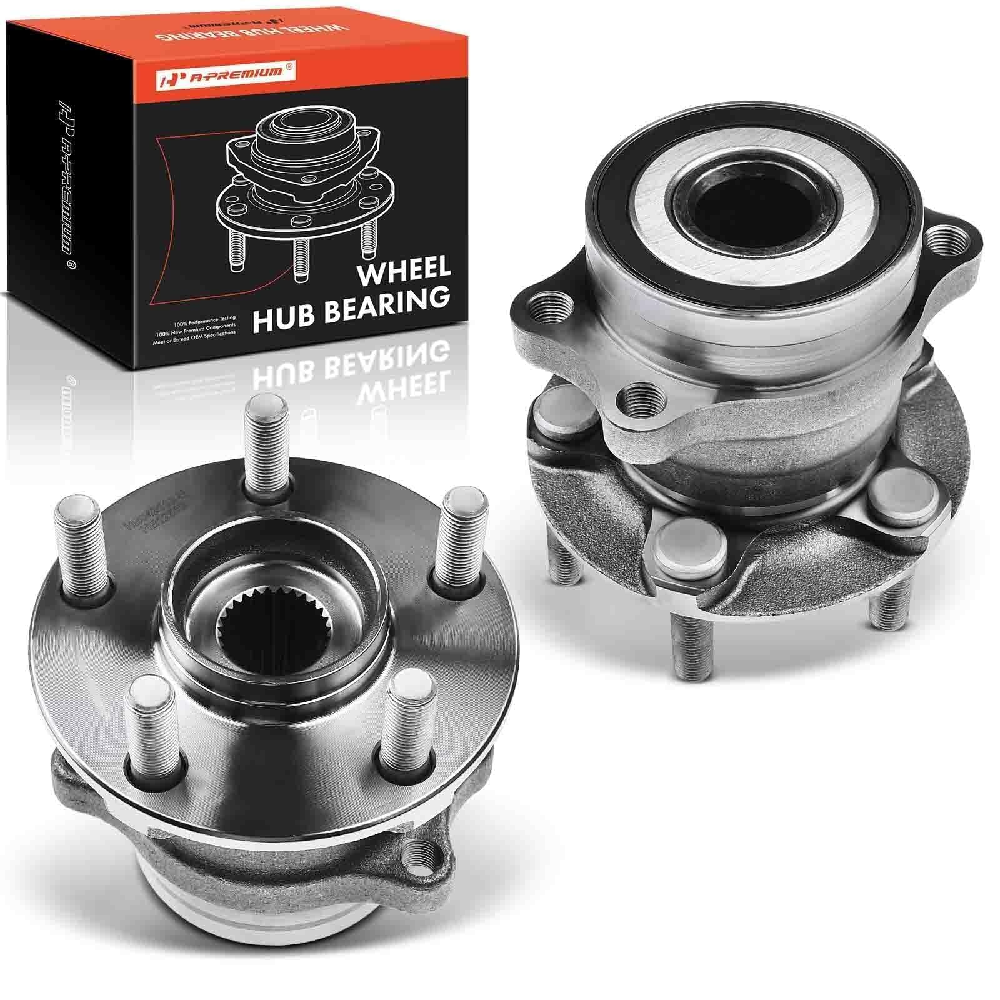 | Автомобильные ступицы Subaru Forester/Impreza с двухрядным радиально-упорным подшипником. Нулевой люфт, динамическая стойкость >38 кН (с избытком выдерживает нагрузку 250 кг). |
| **Привод поворота**<br>(NEMA 23 + Редуктор 1:7.5) | 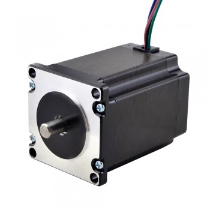<br>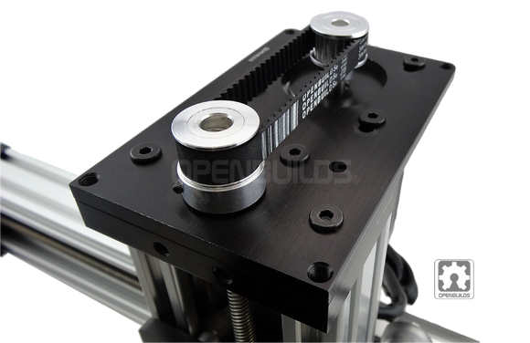 | Шаговый двигатель NEMA 23 (1.9 Н·м, 2.8 А) с зубчато-ременной передачей **GT2 10 мм** (шкивы $z_1=20$, $z_2=150$, $i=7.5$). Итоговый момент на ступице: **13.68 Н·м**, дискретность: **0.03°**. |
| **Тяговый привод 4WD**<br>(Мотор-колеса Xiaomi M365 Pro) | 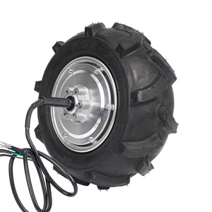 | 4 мотор-колеса Xiaomi Mijia M365 Pro (10", BLDC) номинальной мощностью **260 Вт** каждое, с датчиками Холла и выходом тахометра `SC`. Суммарно 1040 Вт ном. |
| **Локальный контроллер**<br>(Arduino Mega 2560 / Mega Mini) | 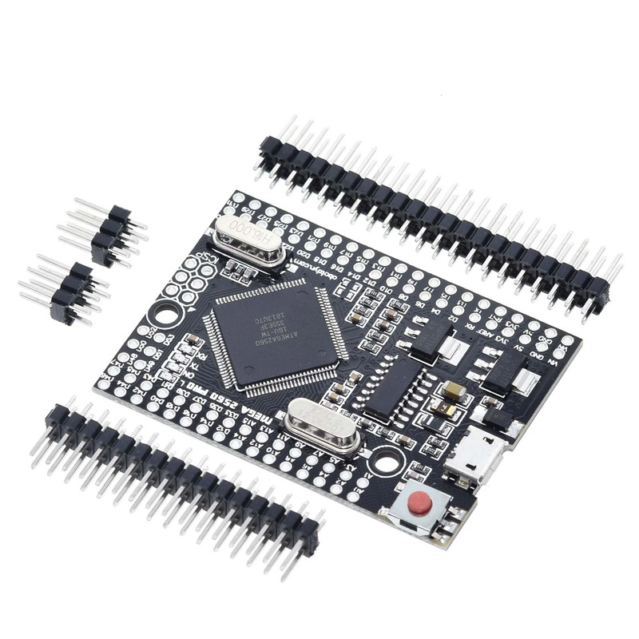 | ATmega2560 (16 МГц, 54 I/O), по 1 плате на каждый из 4 модулей, **свой USB-кабель на каждое колесо**. Шаги руля — Timer2 (10 кГц), тяга — библиотека `Servo` на D3, телеметрия — текстовые кадры с CRC16. |
| **Драйвер шаговика**<br>(TB6600) | 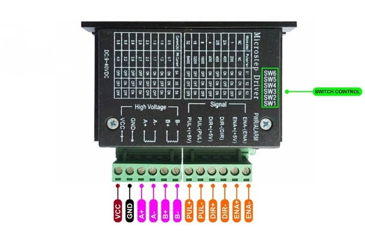 | Микрошаговый драйвер (ток 2.8 А), оптоизолированные входы PUL/DIR/ENA на **D6/D7/D8**, 133.33 шага/град по прошивке, ≈75 °/с. |
| **Драйвер тяги**<br>(RioRand ZS-Z11H) | 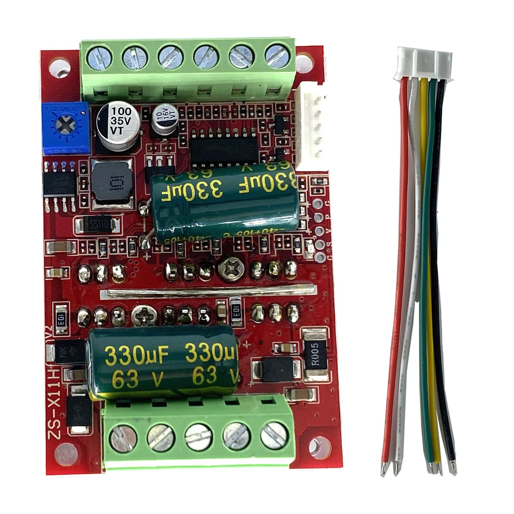 | **Фактический драйвер робота:** готовый 3-фазный драйвер BLDC (ZS-Z11H, бездатчиковый аналог — ZS-X11F). Arduino задаёт тягу сигналом Servo на вход «P» (D3), сторону — DIR (D4), тормоз — BRAKE (D5), разрешение — STOP (D2), читает тахометр SC (D19). Собственный MOSFET-инвертор в `pcb/` — архив v1.0, прошивкой **не используется**. |
| **Тяговая батарея**<br>(LiFePO4 32700 12S3P) | 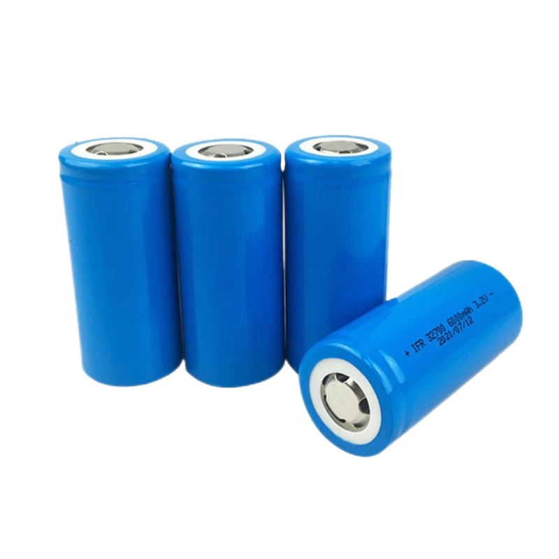 | 36 ячеек LiFePO4 32700 (3.2 В, 6200 мА·ч). Номинал 38.4 В, 18.6 А·ч, 714.2 Вт·ч. Высокая безопасность (не горит, не взрывается), ресурс >2500 циклов. |

---

## 🏗 Архитектура системы управления

Комплекс построен по двухуровневой схеме управления:
1. **Верхний уровень:** Бортовой компьютер под управлением **Ubuntu 24.04/26.04 LTS** со стеком **ROS 2**. Обеспечивает картографирование и локализацию (SLAM), планирование маршрута (Nav2) на основе данных **Лидара LDC 01**, распознавание дорожных знаков («Стоп», «Пешеходный переход», «Искусственная неровность») и светофоров камерой, а также расчет кинематики 4WIS/4WID.
2. **Нижний уровень:** 4 независимых контроллера поворотно-тяговых модулей (**Arduino Mega 2560 / Mega Mini**), каждый со своим USB-кабелем в бортовой ПК. Контроллер выдаёт шаги NEMA 23 (TB6600, D6/D7/D8), управляет драйвером тяги **RioRand ZS-Z11H** (Servo D3, DIR D4, BRAKE D5, STOP D2), читает оптодатчик нуля (D18), потенциометр положения (A0) и тахометр SC (D19), и отдаёт текстовую телеметрию `@F`/`@TLM` с CRC16.


---

## 🛠 Фотографии изготовленного шасси (Промежуточный конструктив)

Реальные фотографии изготовленной несущей рамы и ходовой части мобильной платформы на этапе механической сборки в мастерской (сварочный полуавтомат Aurora PRO Overman, профиль 40×40 мм со скошенными углами 45°, ступицы Subaru, колеса Xiaomi M365 Pro):

| Вид сверху (Рама 40×40 мм, скосы 45°, ступицы Subaru) | Вид сбоку (Вертикальный стек: шпилька → ступица → вилка) | Перспектива 3/4 (Шасси в сборе на 4 колесах) |
| :---: | :---: | :---: |
|  |  | 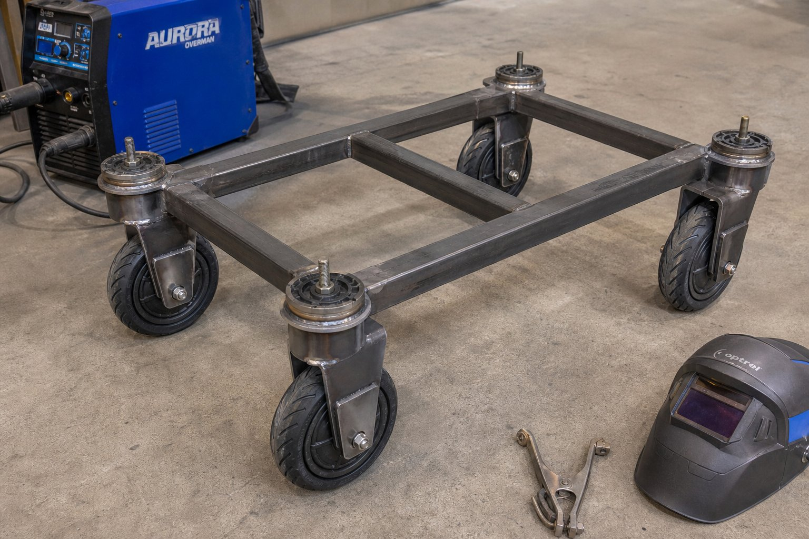 |

---

## 📐 Сборка поворотного модуля (Swerve Pod): Шкив/Шестерня → Ступица → Вилка

Конструкция поворотного модуля строго следует вертикальной иерархии:

```text
  1. [ВЕДОМЫЙ ШКИВ / ШЕСТЕРНЯ z2=150] (СВЕРХУ на центральной шпильке М16/М20)
                     │
  2. [АВТОМОБИЛЬНАЯ СТУПИЦА SUBARU]  (ПОСЕРЕДИНЕ, вварена в раму 40×40 мм)
                     │
  3. [ПОВОРОТНАЯ СТАЛЬНАЯ ВИЛКА]     (СНИЗУ, закреплена к вращающейся части ступицы)
                     │
  4. [МОТОР-КОЛЕСО XIAOMI M365 PRO]  (В ВИЛКЕ, перфорированная шина с красным кантом)
```

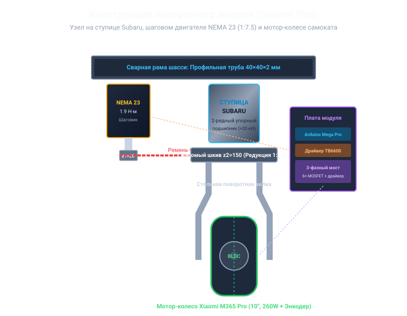

### Ключевые параметры узла:
- **Рама:** Сварная из стальной квадратной трубы 40×40×2 мм (Ст3сп) с диагональными скосами углов 45°;
- **Опорно-поворотный узел:** Автомобильная ступица Subaru с двухрядным радиально-упорным подшипником (>38 кН);
- **Приводная шестерня/шкив сверху:** Ведомый шкив **GT2 10 мм** ($z_2 = 150$), ведущий шкив NEMA 23 ($z_1 = 20$), редукция $1:7.5$;
- **Крутящий момент поворота:** Результирующий момент на ступице **13.68 Н·м** (запас >35% при повороте на месте с грузом 250 кг);
- **Поворотная вилка снизу:** Сварная из листовой стали 5–6 мм;
- **Тяговый привод:** Бесщеточное мотор-колесо Xiaomi M365 Pro 10 дюймов (260 Вт) с цельнолитыми перфорированными шинами, датчиками Холла и встроенным квадратурным энкодером (каналы A/B).

---

## 🔄 Кинематика крабового хода (4WIS / 4WID)

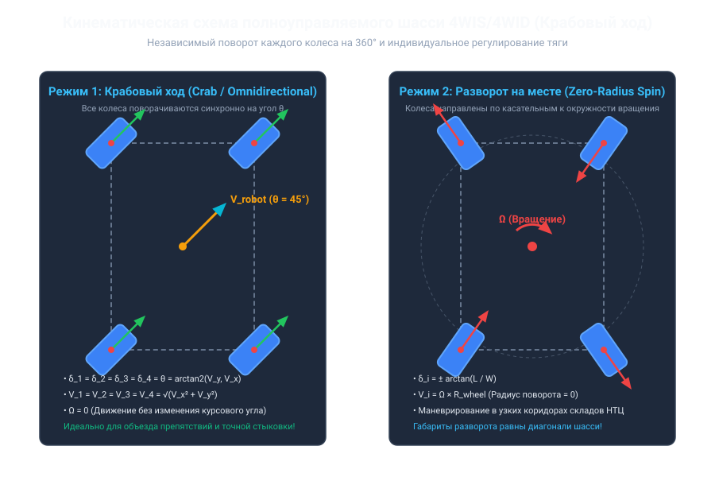

1. **Крабовый ход (Crab Walk):** Все 4 колеса синхронно ориентируются под одинаковым углом $\theta$. Робот перемещается по диагонали или строго вбок без изменения ориентации корпуса ($\omega_z = 0$).
2. **Разворот на месте с нулевым радиусом (Zero-Radius Spin, $R = 0$):** Плоскости качения всех 4 колес разворачиваются **строго по касательным к окружности описания шасси** (перпендикулярно диагональным лучам от центра робота). Векторы тяги колес образуют замкнутый круговой контур в направлении $\Omega$, обеспечивая чистое вращение вокруг центра масс без бокового проскальзывания и износа резины.
3. **Криволинейное движение (Ackerman / Omnidirectional Trajectory):** Согласованное управление углами и скоростями для плавного огибания препятствий.

---

## ⚡ Схема платы модуля управления

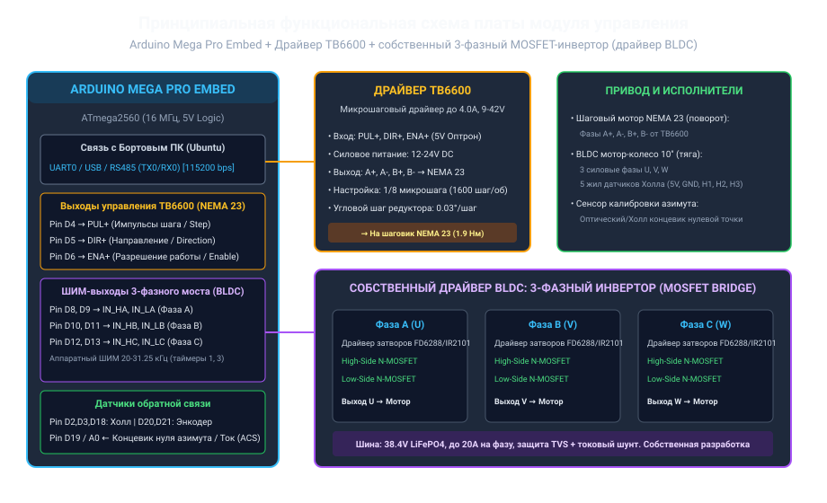

Каждая из 4 плат объединяет микроконтроллер ATmega2560, интерфейс драйвера шагового привода TB6600 (D6/D7/D8) и интерфейс драйвера тяги RioRand ZS-Z11H (STOP D2, Servo D3, DIR D4, BRAKE D5, тахометр SC D19). Плюс оптодатчик нуля руля (D18) и потенциометр положения колеса (A0).

Полная распиновка и уровни сигналов — [`docs/ELECTRICAL_AND_PINOUTS.md`](docs/ELECTRICAL_AND_PINOUTS.md).
Плата из `pcb/` (собственный MOSFET-инвертор) — **проектный архив v1.0**; её пины
не совпадают с текущей прошивкой, см. [`pcb/STATUS.md`](pcb/STATUS.md).

## 🔋 Спецификация батарейного блока LiFePO4 12S 3P

| Параметр | Значение |
| :--- | :--- |
| **Тип ячеек** | Цилиндрические LiFePO4 банки **32700** |
| **Конфигурация** | **12S 3P** (36 банок: 12 последовательных троек) |
| **Номинальное напряжение** | **38.4 В** ($12 \times 3.2$ В) |
| **Диапазон рабочих напряжений** | от 30.0 В (разряд) до 43.8 В (полный заряд) |
| **Емкость сборки** | **18.6 А·ч** ($3 \times 6200$ мА·ч) |
| **Энергоемкость** | **714.2 Вт·ч** |
| **Плата защиты (BMS)** | Smart BMS 12S 60A с контролем температуры ячеек (NTC) и балансировкой |
| **Безопасность** | Полная устойчивость к тепловому разгону, отсутствие риска возгорания |

---

## 📋 Сводная таблица параметров робота

| Параметр | Значение | Соответствие регламенту Задания №2 |
| :--- | :--- | :--- |
| **Габариты платформы (Д × Ш × В)** | **750 × 600 × 400 мм** | Норматив: от 600×400×400 до 1200×800×800 мм ✅ |
| **Полезная грузоподъемность** | **250 кг** | Подтверждено расчетом прочности рамы 40×40 мм и ступиц Subaru ✅ |
| **Размер отсека для груза** | 420 × 340 × 200 мм | Норматив: прямоугольник $\ge 300\times 250\times 60$, цилиндр $\ge 200\times 100$ мм ✅ |
| **Защита груза** | Герметичный отсек IP65 + замок с авторизацией по QR/RFID | Защита от осадков и несанкционированного доступа ✅ |
| **Материал рамы** | Стальная профильная труба 40×40×2 мм, сварная | Прочный цельносварной металлокаркас ✅ |
| **Опорно-поворотные узлы** | Автомобильные ступицы Subaru Forester/Impreza | Двухрядные подшипники, запас прочности под 250 кг груза ✅ |
| **Привод поворота** | 4 × NEMA 23 + ремень **GT2 10 мм** (шкивы 150 и 20), TB6600 на D6/D7/D8 | Редукция 1:7.5, момент 13.68 Н·м, **133.33 шага/град (0.0075°)** по прошивке ✅ |
| **Тяговый привод** | 4 × мотор-колеса Xiaomi M365 Pro 10" (по **260 Вт** BLDC) + драйверы RioRand ZS-Z11H | Полноприводное шасси 4WD, суммарно 1040 Вт ном. ✅ |
| **Управление модулями** | 4 платы (Arduino Mega 2560/Pro + TB6600 + драйвер тяги ZS-Z11H), по одному USB на колесо | Распределённая сеть контроллеров с CRC-телеметрией ✅ |
| **Прошивка** | `firmware/motor_wheel` **fw25**: калибровка по оптодатчику, потенциометр A0, активное удержание угла, сохранённый полный ноль | Единый источник истины для контроллеров ✅ |
| **Бортовой компьютер** | Ubuntu 24.04/26.04 LTS, софт из репозитория **Zapret** (лидар через ROS 2-драйверы, навигация по карте) | Автономная навигация без оператора ✅ |
| **Сенсоры навигации** | **Лидар LDC 01** (360°) + Камера машинного зрения | Распознавание знаков («Стоп», светофор, неровность) ✅ |
| **Световая/звуковая сигнализация**| Светоотражающая оклейка 3M, янтарный маячок, звуковой зуммер 85 дБ | Безопасность в темное время суток и на производстве ✅ |
| **Статус испытаний** | Программа контрольных тестов разработана по регламенту | Готовность к полигонным испытаниям на этапе соревнований ✅ |

---

### Экран робота и веб-пульт (legacy, демо-режим)

> Рабочие экраны робота — в Zapret (`slam_gui/`, `run.py`). Здесь оставлен
> справочный вариант `gui/` с демо-источником `sim`; бинарные кадры 10/16 Б в нём
> **не соответствуют** прошивке fw25.

```bash
python3 gui/backend.py --port 8080     # /  → основной экран робота (киоск)
                                       # /index.html, /console → инженерный пульт
python3 gui/backend.py --kiosk         # то же + браузер без рамок на весь дисплей
node gui/tests/console.test.js         # 32 теста ядра сервисного пульта
python3 gui/tests/backend.test.py      # 40 проверок бэкенда и API
python3 gui/tests/main.screen.test.js  # 38 проверок экрана (нужен jsdom: npm i jsdom)
python3 gui/tests/ui.audit.test.js     # 20 проверок интерфейса: нет дублей кнопок и мёртвых ссылок
python3 gui/tests/console.api.test.js  # 17 сквозных: PIN и журнал общие с бортом
python3 gui/tests/main.api.test.js     # 19 сквозных: экран ↔ живой бэкенд
```

Источник данных для экрана: `--source sim` (стенд), `--source serial`
(4 USB, кадры протокола) или `--source ros` (ROS 2). Доступ к экранам
с планшета — `http://<ip-робота>:8080/`; подробно — [`docs/RUN_AND_ACCESS.md`](docs/RUN_AND_ACCESS.md).

Окно **«Сервис»** (вкладка в сайдбаре) закрывает требования задания № 2 по
защите груза: доступ к ячейке хранения по PIN (заводской `2580`; 5 неудачных
попыток — блокировка 30 с), журнал доступа с хеш-цепочкой, ручное управление
каждым из 4 модулей (руль + тяга, строки протокола fw25), контроль АКБ 12S3P и
статистика с выгрузкой CSV/JSON/печатью. Подробности — [`docs/SERVICE_CONSOLE.md`](docs/SERVICE_CONSOLE.md).

---

## 🚀 Прошивка, сборка и запуск

### 1. Прошивка плат колёс (главный шаг этого репозитория)

Одна плата — одно колесо. Каждая плата прошивается **своей ролью**.

```bash
# 1. Проверить, что скетч вообще собирается (без железа)
g++ -std=c++17 -O1 -w -I tests/firmware_sim/stubs \
    tests/firmware_sim/sim.cpp -o /tmp/wheel-sim && /tmp/wheel-sim

# 2. Собрать .hex тем же avr-gcc, что в Arduino IDE (без IDE)
AVR_ROOT=/путь/к/avr CORE_ROOT=/путь/к/ArduinoCore-avr SERVO_ROOT=/путь/к/Servo \
python3 firmware/tools/avr_build.py firmware/motor_wheel/motor_wheel.ino

# 3. Или собрать и залить одну плату без Arduino IDE
python3 scripts/avr_upload.py --check
python3 scripts/avr_upload.py --sketch-dir firmware/motor_wheel --port /dev/ttyUSB0

# 4. Прочитать версию прошивки с плат (fw=25)
python3 scripts/firmware_probe.py
```

В Arduino IDE: откройте [`firmware/motor_wheel/motor_wheel.ino`](firmware/motor_wheel/motor_wheel.ino),
задайте `MODULE_ID` (`"FL"`, `"FR"`, `"RL"`, `"RR"`), выберите **Arduino Mega or
Mega 2560** и прошейте **по одной плате**, сверяя кабель с реальным колесом.
Подробно, с калибровками и диагностикой — [`firmware/README.md`](firmware/README.md).

> Перед первым включением: вывесить колёса, закрепить раму, подготовить
> **независимый физический E-STOP**. Прошивка не является сертифицированным
> аварийным остановом.

### 2. Бортовой софт (репозиторий Zapret)

Веб-пульт, киоск, навигация и работа с BMS/лидаром живут в
[danilka-revin/Zapret](https://github.com/danilka-revin/Zapret):

```bash
git clone https://github.com/danilka-revin/Zapret.git robot-control
cd robot-control
./scripts/install_ubuntu.sh        # окружение, .env, оператор, ярлык «Запустить робот»
```

По умолчанию `RC_SLAM_SOURCE=master`: бортовой экран сам находит четыре платы по
CRC-защищённой роли FL/FR/RL/RR из прошивки fw22+ — порты вручную не назначаются.

### 3. Справочный ROS 2-стек (legacy, не является рабочим ПО)

```bash
cd ros2_ws
colcon build --symlink-install && source install/setup.bash
ros2 launch rus_slam_bringup robot.launch.py sim:=true   # проверка графа без железа
```

Эти пакеты описывают архитектуру (кинематика, одометрия, мост модулей, Nav2,
восприятие) и **не используются на роботе**. Мост `module_bridge_node` в них
рассчитан на удалённый бинарный протокол; для реального железа нужен
`module_link.py` под текстовый протокол fw25 — см.
[`docs/SOFTWARE_ARCHITECTURE.md`](docs/SOFTWARE_ARCHITECTURE.md), §10.

---

## 👥 Авторы и принадлежность

- **Организация:** НТЦ АО «АВТОВАЗ» / Конкурс «Первые в профессии»
- **Направление:** Транспортная сфера «Автомобильный транспорт»
- **Задание:** Задание № 2 «Автономное роботизированное транспортное средство для внутренней логистики НТЦ АО «АВТОВАЗ»»
- **Лицензия:** MIT License
