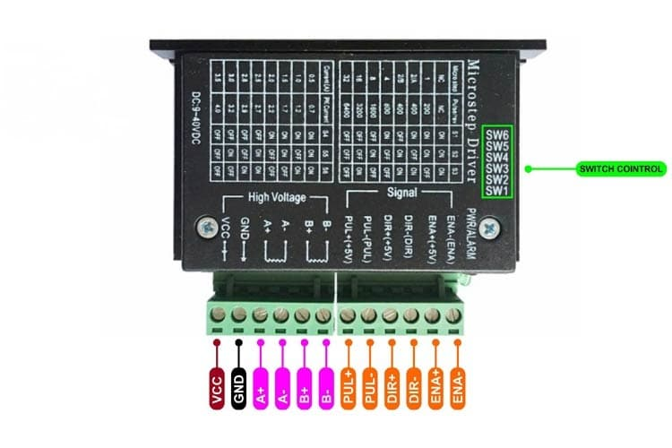
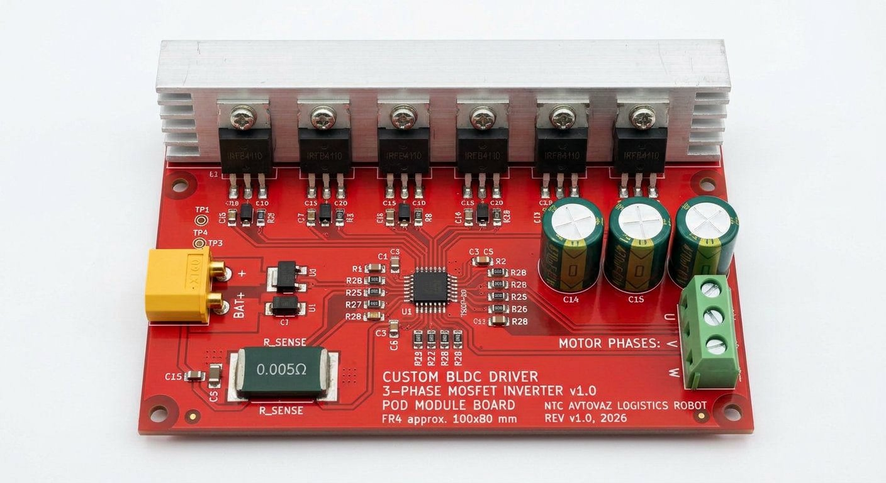
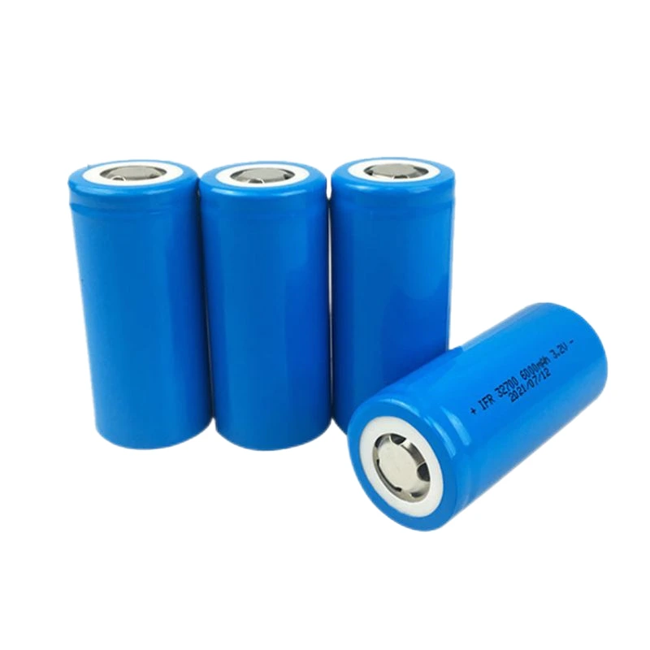

# ЭЛЕКТРИЧЕСКИЕ СХЕМЫ, ТАБЛИЦЫ РАСПИНОВОК И ПОДКЛЮЧЕНИЙ

## Плата управления поворотным модулем (Smart Wheel Pod Board)
### Состав: Arduino Mega Pro Embed + TB6600 (руль) + драйвер тяги RioRand ZS-Z11H

> **Сверено с прошивкой.** Этот документ описывает распиновку, которую реально
> использует [`firmware/motor_wheel/motor_wheel.ino`](../firmware/motor_wheel/motor_wheel.ino)
> (fw25). Источник истины — скетч; при расхождении прав скетч и
> [`firmware/README.md`](../firmware/README.md).

---

## 1. СТРУКТУРНАЯ СХЕМА ПИТАНИЯ РОБОТА

Энергетическая система робота построена на двухуровневой шине питания:

```text
    АКБ LiFePO4 12S 3P (36 ячеек 32700) -> [38.4V Номинал / 43.8V Макс]
                            │
               ┌────────────┴────────────┐
               │                         │
     [Автомат 63A + Аварийный Грибок]    │
               │                         │
         [Smart BMS 60A]                 │
               │                         │
   Силовая шина 38.4V DC                 │
   ├──> 4 × драйвера тяги RioRand ZS-Z11H │
   │    (3-фазные драйверы BLDC с датчиками Холла)
   │    (Тяговые мотор-колеса Xiaomi M365 Pro 260 Вт)
   │                                     │
   ├──> Преобразователь DC-DC 38V -> 24V (10A)
   │    └──> 4 × Драйвера TB6600 (Шаговики NEMA 23, редуктор GT2 150/20)
   │
   ├──> Преобразователь DC-DC 38V -> 12V / 5V (бортовой ПК, лидар, фары)
   │    └──> Бортовой компьютер Ubuntu, лидар, маячок, звуковой сигнал
   │
   └──> Преобразователь DC-DC 12V -> 5V (5A)
        └──> Питание логики: 4 × Arduino Mega Pro, оптодатчик D18,
             потенциометр A0, USB-Hub
```

---

## 2. РАСПИНОВКА ARDUINO MEGA PRO (EMBED) НА ПЛАТЕ МОДУЛЯ

На каждом из 4 модулей установлена плата с микроконтроллером **Arduino Mega Pro (Embed, ATmega2560)**.

| Пин Mega Pro | Обозначение | Назначение / Цепь | Тип сигнала | Уровень напряжения |
| :--- | :--- | :--- | :--- | :--- |
| **D0 (RX0)** | `RXD` | Приём команд от бортового ПК (Ubuntu), USB-CDC/UART0 | Цифровой вход (UART) | 5.0 В (TTL) |
| **D1 (TX0)** | `TXD` | Передача `@F`/`@TLM`/`# …` бортовому ПК | Цифровой выход (UART) | 5.0 В (TTL) |
| **D2** | `BLDC_STOP` | Вход «разрешить» драйвера ZS-Z11H: **HIGH — выходы включены, LOW — свободный выбег** | Цифровой выход | 5.0 В |
| **D3** | `BLDC_SPEED` | Сигнал Servo (~50 Гц) на вход «P» драйвера, `Servo.write(0…150)` | Выход (библиотека Servo) | 5.0 В |
| **D4** | `BLDC_DIR` | Сторона вращения (у FR/RR инвертирована прошивкой) | Цифровой выход | 5.0 В |
| **D5** | `BLDC_BRAKE` | Тормоз драйвера: HIGH — заторможен | Цифровой выход | 5.0 В |
| **D6** | `STEP_PUL` | Импульсы шага → TB6600 (`PUL+`) | Импульсный выход | 5.0 В (HIGH) |
| **D7** | `STEP_DIR` | Направление → TB6600 (`DIR+`): LOW — «вправо» (шаги растут) | Цифровой выход | 5.0 В |
| **D8** | `STEP_ENA` | Разрешение → TB6600 (`ENA+`): HIGH с момента включения | Цифровой выход | 5.0 В |
| **D18** | `OPTO` | Оптодатчик нуля руля, `INPUT_PULLUP`, сработал = LOW | Цифровой вход | 5.0 В (pull-up) |
| **D19** | `BLDC_SC` | Тахометр драйвера: `INPUT_PULLUP`, INT2 на оба фронта | Цифровой вход прерывания | 5.0 В (pull-up) |
| **A0** | `POT` | Потенциометр положения колеса 10 кОм / 270° (на Mega — вывод 54) | Аналоговый вход (АЦП) | 0…5 В |
| **+5V** | `VCC` | Питание цифровой части микроконтроллера | Питание | 5.0 В DC |
| **GND** | `GND` | Общий провод сигнальной земли | Земля | 0 В |

**Таймеры.** Шаги руля выдаёт **Timer2** (16 МГц / 8 / 100 = 20 кГц, тик 50 мкс),
тяга — штатная библиотека `Servo` (на Mega занимает свои таймеры, начиная с
Timer5). `tone()` и `analogWrite()` в прошивке не используются, своих ISR
Timer1/3/4/5 нет — поэтому руль и тяга не конфликтуют.

**Свободные выводы.** D9–D17, D20–D21, A1–A15 в текущей прошивке не заняты.
Квадратурный энкодер мотор-колеса (D20/D21) и датчики Холла (D2/D3) **не
подключаются к Mega**: коммутацию тяги выполняет сам драйвер ZS-Z11H, а прошивка
получает только тахометр `SC` на D19.

---

## 3. ПОДКЛЮЧЕНИЕ ДРАЙВЕРА ШАГОВОГО ДВИГАТЕЛЯ TB6600



### 3.1. Таблица коммутации разъема TB6600

| Контакт TB6600 | Подключение к плате | Описание |
| :--- | :--- | :--- |
| **PUL+** | Pin **D6** Arduino Mega Pro | Сигнал шага (импульс не короче 2.5 мкс) |
| **PUL−** | `GND` платы | Общий катод оптопары импульсов |
| **DIR+** | Pin **D7** Arduino Mega Pro | Направление: **LOW — «вправо»** (шаги растут), HIGH — «влево» |
| **DIR−** | `GND` платы | Общий катод оптопары направления |
| **ENA+** | Pin **D8** Arduino Mega Pro | HIGH **с момента включения**, выходы всегда разрешены |
| **ENA−** | `GND` платы | Общий катод оптопары разрешения |
| **VCC** | Линия +24 В DC | Силовое питание шагового двигателя |
| **GND** | Силовая земля `PGND` | Минусовой силовой провод |
| **A+ / A−** | Обмотка A NEMA 23 | Чёрный / зелёный провод |
| **B+ / B−** | Обмотка B NEMA 23 | Красный / синий провод |

### 3.2. Настройка DIP-переключателей TB6600

| Параметр | DIP | Значение в прошивке |
| :--- | :--- | :--- |
| Микрошаг | S1…S3 | нужно подобрать под **133.33 шага/град** (`STEPS_PER_DEGREE`) |
| Ток | S4…S6 | 2.8 А (номинал NEMA 23 1.9 Н·м) |

> **Важно:** прошивка `motor_wheel` задаёт `STEPS_PER_DEGREE = 133.333333` — это
> результат, снятый с **проверенного на железе** скетча
> ([`firmware/reference/steering_tested/`](../firmware/reference/steering_tested/steering_tested.ino)).
> Дробление TB6600, редукция GT2 и число шагов мотора должны вместе давать
> именно это число; иначе все углы на экране будут врать в `k = 133.33 / факт`
> раз. После изменения DIP-переключателей пересчитайте `STEPS_PER_DEGREE` и
> проверьте угол транспортиром при `d 90 f`, прежде чем выезжать.

### 3.3. Скорость шагов

| Режим | Период | Частота | Примерная скорость |
| :--- | :--- | :--- | :--- |
| Рабочий ход | 100 мкс | 10 кГц | ≈ 75 °/с |
| Точный подход к оптодатчику | 2000 мкс | 500 Гц | ≈ 3,75 °/с |
| Активное удержание угла | 400 мкс | 2.5 кГц | ≈ 18 °/с |

---

## 4. ДРАЙВЕР ТЯГИ: RIORAND ZS-Z11H (КУПОТЕЧНЫЙ, ВНЕ ПЛАТЫ КОНТРОЛЛЕРА)



> **Статус по факту.** Тяговое мотор-колесо крутит готовый драйвер бесколлекторного
> мотора **RioRand ZS-Z11H** (3 фазы + датчики Холла; бездатчиковый аналог —
> ZS-X11F). Прошивка `motor_wheel` **не выполняет 6-тактную коммутацию** и не
> управляет MOSFET-мостом: она подаёт на драйвер сигнал Servo на вход «P» (D3),
> уровни DIR/BRAKE/STOP (D4/D5/D2) и читает тахометр SC (D19). Коммутацию,
> ограничение тока и защиту мотора выполняет сам ZS-Z11H.

### 4.1. Подключение драйвера

| Линия драйвера | Куда | Что делает |
| :--- | :--- | :--- |
| **P** (PWM, площадка рядом с перемычкой J1) | **D3** | скважность ШИМ задаёт тягу; перемычка **J1** должна быть замкнута |
| **G** / `GND` | общий GND платы | сигнальная земля |
| **DIR** | **D4** | сторона вращения |
| **BRAKE** | **D5** | HIGH — тормоз включён |
| **STOP** | **D2** | HIGH — выходы разрешены, LOW — свободный выбег |
| **SC** (площадка `S`) | **D19** | тахометр, оба фронта, INT2 |
| `V` (5 В) | **не подключать** | прошивке не нужно |
| Силовые фазы + датчики Холла | к драйверу | Mega к ним не подключается |

На самой плате драйвера один раз отвёрткой: замкнуть J1, подстроечник скорости
выкрутить **до упора против часовой** (в минимум), припаять провод с площадки P на
D3 и с площадки S на D19.

### 4.2. Сигнал тяги

Прошивка использует **штатную библиотеку Servo**: `drive_servo.attach(D3)` и
`drive_servo.write(N)`, N = 0…150 прямо из бортового ползунка. Стандартный импульс
Servo — 544…2400 мкс с периодом ~20 мс, то есть **2.7…12 % скважности**. Вход «P»
понимает ШИМ по скважности, поэтому это лишь часть его диапазона, а не протокол
сервопривода; число `write()` не является измерением оборотов. Значение 0
останавливает мотор линиями BRAKE/STOP, а не нулевым импульсом.

| Параметр | Значение |
| :--- | :--- |
| Предел прямого `v` | 0…150 (вне — отклоняется, выход гасится) |
| Предел `t` | ±100 % шкалы Servo, 1 % ≈ 1.8 значения `write` |
| Watchdog тяги | **650 мс** без команды → 0 и тормоз |
| Переходов SC на оборот | 90 (`TACH_EDGES_PER_REV`, подлежит проверке на конкретном моторе) |

### 4.3. Про альтернативную плату с MOSFET-инвертором

В `pcb/` лежит **проектная** плата собственного контроллера с 6 × IRFB4110 и
драйвером затворов FD6288Q (см. [`../pcb/`](../pcb/README.md)). Это отдельная
разработка, которая **не совпадает** с текущей прошивкой: в `motor_wheel` нет ни
одной строки 6-тактной коммутации, а выводы D8–D13 в ней заняты TB6600 (D8) и
свободны. Пока плата не будет приведена к пинам прошивки (или наоборот), тяга
идёт через ZS-Z11H. Документ `pcb/SCHEMATIC_CIRCUIT_DESIGN.md` сохранён как
инженерный архив и помечен как не соответствующий прошивке.

---

## 5. СХЕМА СБОРКИ АККУМУЛЯТОРНОЙ БАТАРЕИ 12S 3P (36 БАНОК 32700)



Батарея смонтирована в ударопрочном защитном коробе с фиксацией банок в пластиковых сотовых ячейках-холдерах типоразмера 32700.

1. **Коммутация банок:**
   - 3 параллельные ячейки соединяются между собой точечной сваркой никелированной медной шиной толщиной 0.2 мм и шириной 10 мм;
   - 12 параллельных троек соединяются последовательно (12S);
   - Выводы балансировочного шлейфа (13 проводов) подключены к разъему Smart BMS.
2. **Токовые цепи:**
   - Силовые провода сечением **8 AWG** (термостойкая силиконовая изоляция до 200°C);
   - Силовой разъем: **XT90-S** (с встроенной антиискровой защитой);
   - Главный предохранитель: автомобильный флажковый **MAXI 60A**.
